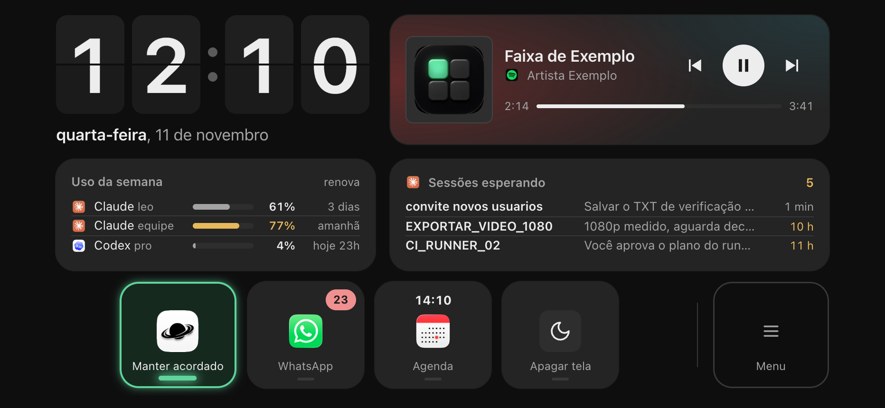
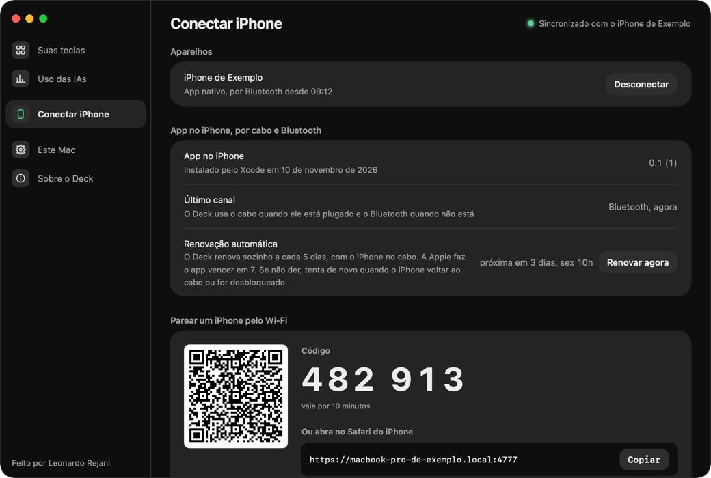

<!-- readme-padrao:header -->
<div align="center">
  
</div>

<div align="center">
  
</div>

<div align="center">

  <p><strong>O iPhone deitado do lado do Mac vira um painel de mesa e um teclado de atalhos.</strong></p>

  <p>
    
    
    
    
    <a href="LICENSE"></a>
    <a href="https://github.com/leonardorejani/deck_os/stargazers"></a>
  </p>

  <p>
    <a href="#por-que-existe">Por que existe</a> •
    <a href="#o-que-faz">O que faz</a> •
    <a href="#como-funciona">Como funciona</a> •
    <a href="#stack">Stack</a> •
    <a href="#rodar-local">Rodar local</a> •
    <a href="#documentação">Documentação</a> •
    <a href="#contribuir">Contribuir</a> •
    <a href="#licença">Licença</a>
  </p>
</div>

<br>

<div align="center">
  
</div>

## O que é

```yaml
produto:   painel de mesa no iPhone que mostra e controla o Mac, sem servidor na internet
quem_usa:  quem trabalha no Mac e quer o iPhone parado do lado como painel e teclado de atalhos
estado:    construído (Mac, painel PWA e app nativo), falta o teste final no aparelho
```

<!-- /readme-padrao:header -->

## Por que existe

O iPhone carregando do lado do Mac fica parado, e nada junta painel e teclas na mesma tela. O StandBy do iOS mostra
widgets, mas não roda teclas. Companion, slate e MiniDeck fazem só teclas. O Deck junta as duas coisas num app só, grátis,
e nada do que ele lê do Mac passa por servidor de terceiro.

## O que faz

- **Painel de relance.** Relógio grande, Spotify com a capa, uso semanal das contas de IA, sessões do Claude esperando resposta e as não lidas do WhatsApp.
- **Teclas que executam no Mac.** Atalho de teclado, abrir app e comando de terminal. A tecla acende quando a função está ligada.
- **O Mac configura, o iPhone mostra.** Toda a configuração mora nos Ajustes do Mac. O modo organizar do iPhone (segurar e arrastar) grava no mesmo lugar.
- **Menu.** Uma tecla isolada leva a "Nova tecla" e a "Perfil", então a tela não ganha seletor.
- **Dois caminhos no iPhone.** O rápido (PWA pelo Wi-Fi) e o completo (app nativo, que ganha cabo, Bluetooth e vibração).
- **Tela acesa e sem queimar.** Wake Lock no HTTPS local e deslocamento de 1 a 2 px a cada 3 minutos.
- **Sempre escuro, sem emoji.** Visual com tokens do design system tatile, conferido por auditor.

<div align="center">
  
</div>

## Como funciona

```
iPhone                                         Mac (Deck.app, barra de menus)
  PWA pelo Wi-Fi  ---- HTTPS, porta 4777 ---->   servidor com certificado local
  App nativo      ---- cabo (usbmuxd) -------->  mesma API, em quadros pelo fio
                  ---- Bluetooth cifrado ----->  EventKit, AppleScript, sqlite do WhatsApp,
                                                 CGEvent, atalhos e leitura de jobs e uso
```

- **Código de acesso:** a API exige um código de 20 letras gerado no primeiro uso. Ele troca sozinho a cada 24 horas e o iPhone atualiza pelo cabeçalho `X-Deck-Codigo-Novo`, sem parear de novo.
- **Certificado:** o Mac cria um certificado só dele. O iPhone instala e confia nele uma vez (QR do Conectar iPhone), e por isso o PWA consegue manter a tela acesa e abrir sem o Mac.
- **Canal do app nativo:** o cabo é o canal em uso quando está plugado, e o Bluetooth assume na hora quando ele sai, com um aviso de 3 segundos.
- **Renovação:** com conta grátis da Apple o app nativo vence em 7 dias. O Deck do Mac renova sozinho a cada 5 dias, com o iPhone no cabo ou no mesmo Wi-Fi, e avisa só se não der.
- **Sem internet:** o iPhone recebe a página do próprio Mac. Fora do Wi-Fi de casa o PWA não conecta, e o app nativo continua pelo cabo e pelo Bluetooth.

## Instalar

### 1. O Mac (uma vez)

Precisa de Xcode e `brew install xcodegen`.

```bash
./build.sh
```

Gera `dist/Deck-1.0.dmg`. Abra, arraste o Deck para Aplicativos e abra. Sem a conta paga da Apple, o macOS bloqueia a primeira
abertura: vá em Ajustes do Sistema > Privacidade e Segurança e toque em "Abrir mesmo assim", uma vez só.

**Abra o Deck pelo Finder, pelo Launchpad ou pelo Spotlight.** Nunca por `open` de dentro de um terminal (Terminal, iTerm,
Orca): o macOS 26 prende o ícone da barra de menus ao app do terminal, e se ele estiver desligado em Ajustes do Sistema >
Barra de Menus > Permitir na Barra de Menus, o ícone do Deck some. Quem constrói o app pode usar `./build.sh --abrir` ou
`scripts/abrir-deck.sh`, que pedem ao Finder.

### 2. O iPhone, caminho rápido (PWA pelo Wi-Fi)

1. No Mac, abra o Deck na barra de menus e vá em Ajustes > Conexões.
2. Leia o QR com a câmera do iPhone e siga a tela: baixar o certificado, instalar o perfil e confiar nele em Ajustes > Geral > Sobre > Ajustes de Confiança de Certificados.
3. No Safari, Compartilhar > Adicionar à Tela de Início.

Nada para compilar. Fica no mesmo Wi-Fi do Mac.

### 3. O iPhone, caminho completo (app nativo pelo Xcode)

Com o cabo, o Bluetooth e a vibração. Precisa de uma Apple ID entrando no Xcode (Settings > Apple Accounts), a conta grátis serve.

```bash
./instalar-iphone.sh
```

O script confere o Xcode, a conta e o iPhone desbloqueado no cabo, e instala. Depois, o Deck do Mac renova o app sozinho a cada 5 dias.
No iPhone, em Ajustes > Geral > VPN e Gerenciamento de Dispositivo, confie no seu perfil de desenvolvedor na primeira vez.

### Spotify

Já vem pronto: o Deck leva a chave do app dele no Spotify, então em Ajustes > Este Mac > Spotify é só clicar em "Conectar ao Spotify"
e entrar na sua conta. O app do Spotify em modo de desenvolvimento só aceita as contas que o dono adicionar em User Management
(até 25). Quem não estiver na lista, ou preferir a sua, usa "Avançado: usar a minha própria chave do app".

Quem faz um fork configura a própria chave:

1. Em developer.spotify.com/dashboard, crie um app, marque **Web API** e cadastre em Redirect URIs `http://127.0.0.1:4778/retorno`.
2. Copie o Client ID (32 letras e números). Ele não é segredo, o login usa PKCE.
3. Cole em `ChaveSpotify.embutida`, em `mac/Nucleo/Spotify/ChaveSpotify.swift`, e gere o app de novo. Sem isso, a tela pede a chave para a pessoa colar.

## Stack

| Camada | O que usa |
|---|---|
| Painel (iPhone) | HTML, CSS e JavaScript puros, PWA com service worker e Wake Lock |
| Núcleo do Mac | Swift 6, pacote `Nucleo` sem tela (compila no Mac e no Linux do CI) |
| App do Mac | SwiftUI, `MenuBarExtra`, xcodegen |
| App nativo do iPhone | SwiftUI e WKWebView, pacote `DeckCasca`, cabo por usbmuxd e Bluetooth (Curve25519 e ChaChaPoly) |
| Design | tokens da tatile, auditor com 0 erros |
| WhatsApp por QR | ajudante em Go (`helpers/whatsapp`) com a whatsmeow (MPL-2.0), opcional |
| CI | runner próprio (rótulo `leve`) ou do GitHub, testes em `swift:6.2` |

## Rodar local

```bash
# painel contra o Mac de mentira (precisa do Chrome)
node painel/teste/rodar.mjs

# núcleo e app nativo, sem tela
swift test --package-path mac
swift test --package-path ios/Pacote

# critério de pronto do projeto
.claude/verificar.sh

# protótipo navegável, sem conta
cd prototipo && python3 -m http.server 4871
```

## Documentação

| Doc | O que é |
|---|---|
| [`SPEC.md`](SPEC.md) | O produto: telas, teclas, dados, arquitetura, instalação e decisões |
| [`PLANO.md`](PLANO.md) | As fases da construção e a prova de cada uma |
| [`docs/provas/`](docs/provas) | Provas reais de cada fase, incluindo o roteiro do teste final em [`teste-final.md`](docs/provas/teste-final.md) |
| [`docs/lessons/`](docs/lessons) | Lições catalogadas da construção |
| [`CLAUDE.md`](CLAUDE.md) | Mapa do repo e regras de trabalho |

## Contribuir

O Deck é código aberto. Gostou? Dê uma estrela no repositório, ela ajuda outras pessoas a achar o projeto (também tem o
botão "Dar uma estrela no GitHub" em Ajustes > Sobre o Deck, no app do Mac). Achou um erro ou tem uma ideia, abra uma
[issue](https://github.com/leonardorejani/deck_os/issues/new/choose). Quer mexer no código, leia o
[`CONTRIBUTING.md`](.github/CONTRIBUTING.md): como rodar os testes, o fluxo de PR e o que o CI confere.

### WhatsApp por QR (opcional, desligado por padrão)

Além do app do WhatsApp e do WhatsApp Web, o Deck pode ler as conversas como um "aparelho conectado" (você lê um QR
no celular). É um ajudante em Go (`helpers/whatsapp/`) que usa a biblioteca
[whatsmeow](https://github.com/tulir/whatsmeow), licença [MPL-2.0](https://www.mozilla.org/MPL/2.0/) (o código dela não é
alterado aqui, e o texto da licença segue com a dependência). **Não é oficial e viola os termos do WhatsApp.** Só lê,
não envia e não marca como lido. Ocupa uma das 4 conexões do WhatsApp. Para sair, apague o aparelho "Deck (só leitura)"
em Aparelhos conectados no celular. Liga em Ajustes > Este Mac > WhatsApp. O `build.sh` precisa do Go
(`brew install go`) para embutir o ajudante, e sem ele o Deck sai sem essa opção.

## Licença

[MIT](LICENSE), Leonardo Rejani, 2026. Use, copie e modifique à vontade, mantendo o aviso de direitos.

<!-- readme-padrao:footer -->
<br>

---

<div align="center">
  <p><strong>Feito por <a href="https://github.com/leonardorejani">Leonardo Rejani</a></strong></p>
  <a href="https://github.com/leonardorejani">
    
  </a>
  <a href="https://instagram.com/leonardorejani">
    
  </a>
</div>

<br>

<div align="center">
  
</div>
<!-- /readme-padrao:footer -->
